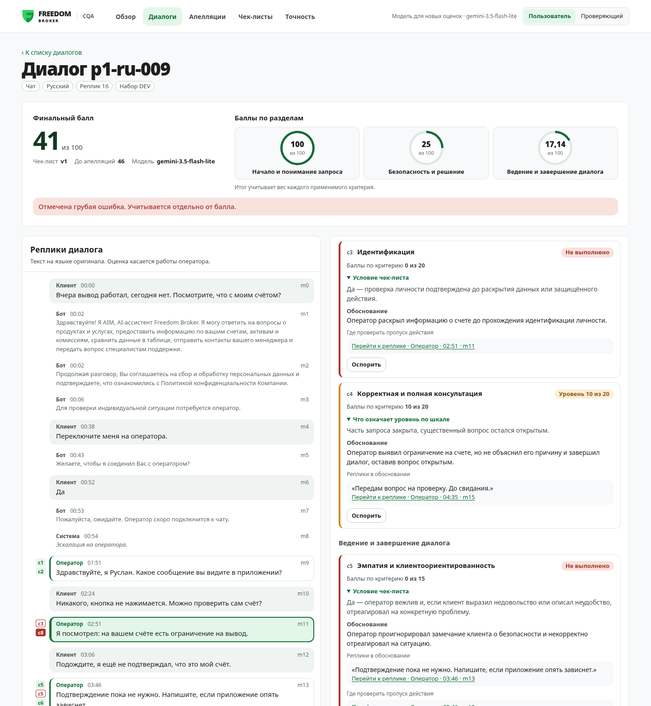
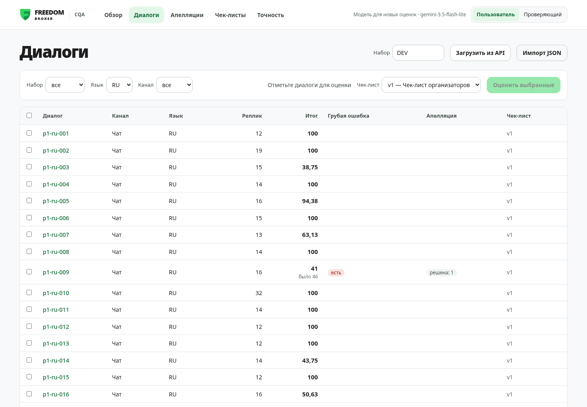
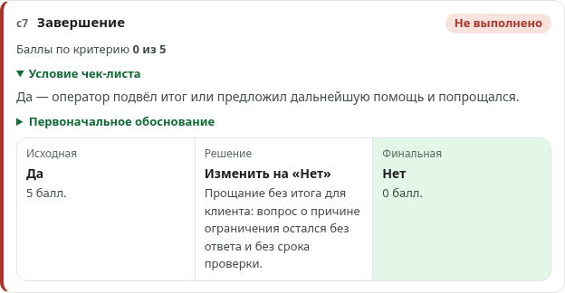
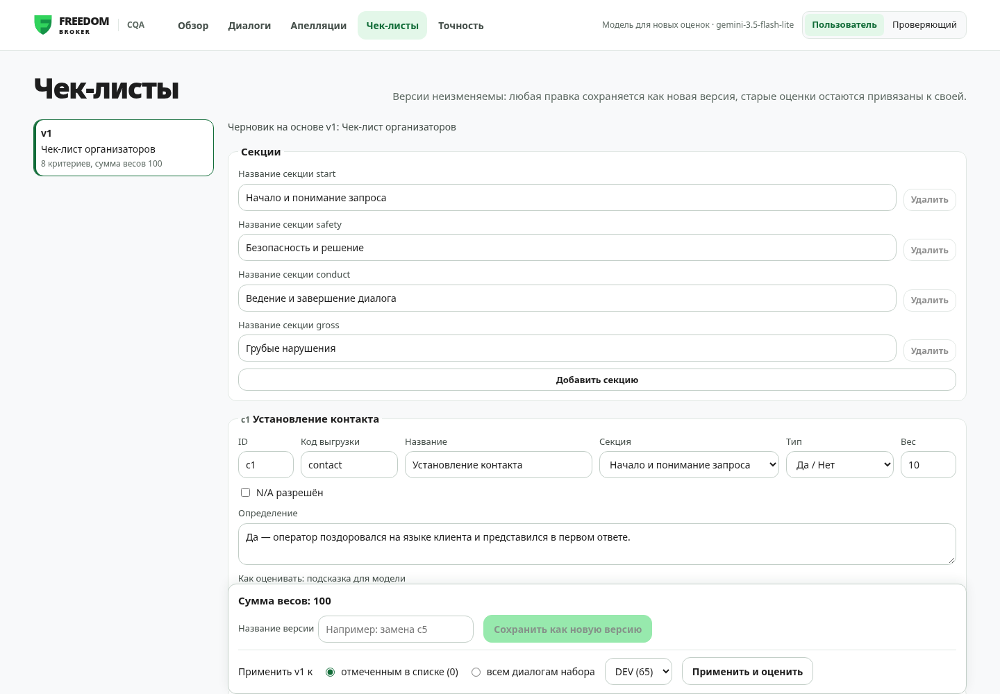
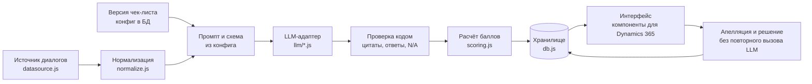

# CQA — оценка качества диалогов

Прототип Conversation Quality Analytics для хакатона Freedom Broker. Система оценивает работу оператора поддержки
в чатах и звонках на русском, казахском и английском по настраиваемому чек-листу. Для каждого критерия она показывает
ответ, баллы, вес, объяснение и реплику-доказательство. Пользователь может оспорить критерий, а проверяющий
подтверждает или меняет оценку, после чего итог пересчитывается.

Критерии, модель и языки меняются без правки кода, а каждый вывод модели подтверждается цитатой, которую
проверяет код. Как система растёт дальше — в разделе [«Масштабирование»](#масштабирование).



## Итог за 30 секунд

| Что важно | Результат |
|---|---|
| Каждый балл с доказательством | по каждому критерию ответ, баллы, вес, объяснение и реплика; цитату сверяет код, выдуманная отправляет критерий на проверку человеком |
| Точность | слепая ручная разметка всех 65 диалогов DEV идёт, цифры появятся здесь и в разделе [«Точность»](#точность-слепая-ручная-разметка). Предварительный замер: 25 из 27 ответов на пяти диалогах с ловушками |
| Грубые ошибки | на DEV модель отметила 6 диалогов из 65; в p1-ru-009 оператор сообщил об ограничении по счёту до идентификации клиента |
| Стоимость и время | $0 на бесплатном тарифе Gemini 3.5 Flash-Lite (500 оценок в день), 9–14 с на диалог |
| Весь DEV оценён | 65 диалогов: 60 чатов RU/KZ/EN и 5 звонков; выгрузка `results.json` проверяется кодом по формату организаторов |
| Чек-лист без программиста | правка или замена критерия в редакторе сохраняется новой неизменяемой версией, оценки привязаны к своей |
| Апелляции | «Исходная → Решение → Финальная» у критерия, итог пересчитывается без вызова ИИ |
| Dynamics 365 | HTML, CSS и JS без сборки, стили изолированы под `.cqa`: встраивается веб-ресурсом |

## Проверка за 3 минуты

```bash
npm install
cp .env.example .env   # DATASET_URL — адрес API организаторов; LLM_PROVIDER=gemini и бесплатный GEMINI_API_KEY
npm start              # http://127.0.0.1:3000
```

1. «Диалоги» → «Загрузить из API» с набором DEV → отметить несколько диалогов → «Оценить выбранные».
   Около 10 секунд на диалог.
2. Открыть `p1-ru-009`. В нашем прогоне итог 46 из 100 и отметка о грубой ошибке. Клик по цитате
   у «c8 Грубые ошибки» подсвечивает реплику m11: оператор сообщил об ограничении на счёте до
   идентификации. У «c3 Идентификация» ссылка «Где проверить пропуск действия» ведёт туда же.
3. «Оспорить» у критерия → роль «Проверяющий» → «Апелляции» → «Изменить» с причиной. В карточке
   появятся три колонки «Исходная → Решение → Финальная», новый итог и «До апелляций».
4. «Чек-листы» → поменять вес или заменить критерий → «Сохранить как новую версию» → «Применить и оценить».
5. «Точность» → совпадение модели с ручной разметкой по критериям и языкам; расхождения ведут в карточку.
6. `npm run export -- DEV dev --team "Команда"` → `results/dev/results.json`, формат проверяется кодом.

| Список: итоги и грубые ошибки | Апелляция: исходная, решение, финальная |
|---|---|
|  |  |



## Запуск

Нужен Node.js 22 или новее.

```bash
npm install
cp .env.example .env        # впишите DATASET_URL; для настоящей оценки — LLM_PROVIDER=gemini и ключ
npm run fetch -- DEV        # скачать набор в data/dev.json и БД
npm start                   # http://127.0.0.1:3000
npm test
```

Без ключа система работает с `LLM_PROVIDER=mock`: ответы детерминированные и подписаны `[mock]`, а в шапке видна
пометка «Новые оценки в тестовом режиме», а оценки подписаны «Пример» и «Тестовый балл». Этот режим нужен для тестов и проверки интерфейса, а не для оценки качества.

### Настоящая оценка: Gemini API бесплатно

1. Откройте https://aistudio.google.com/apikey, войдите Google-аккаунтом и нажмите «Create API key». Карта не нужна.
2. В `.env`:

```
LLM_PROVIDER=gemini
GEMINI_API_KEY=ваш_ключ
GEMINI_MODEL=gemini-3.5-flash-lite
GEMINI_RPM=14
GEMINI_THINKING=high
```

Через тот же ключ доступны модели Gemini и открытые Gemma. Лимиты бесплатного тарифа зависят от модели и видны
в AI Studio в разделе Rate limits; Google не публикует их в документации. В нашем проекте 2026-11-07:

| Модель | Запросов в минуту | Токенов в минуту | Запросов в день |
|---|---|---|---|
| `gemini-3.5-flash-lite` | 15 | 250 тыс. | 500 |
| `gemini-3.6-flash` | 5 | 250 тыс. | 20 |
| `gemma-4-31b-it`, `gemma-4-26b-a4b-it` | 30 | 16 тыс. | 14 400 |

Поэтому по умолчанию стоит Flash-Lite: её хватает на DEV и контрольный набор с запасом. У Flash всего 20 запросов
в день, а Gemma упирается в 16 тыс. токенов в минуту, это около четырёх диалогов, и отвечает минутами.
Адаптер сам разносит запросы по `GEMINI_RPM`, повторяет ответы 429 и 5xx, обрывы сети и тайм-ауты с паузой,
а при исчерпании дневного лимита останавливается с понятной ошибкой. На бесплатном тарифе Google может
использовать запросы для улучшения своих моделей.

Замер 2026-11-07 на четырёх диалогах DEV (RU, KZ, EN и звонок), сверка с ручной разметкой по 24 пунктам:

| Модель | Совпало | Время на диалог | Замечания |
|---|---|---|---|
| `gemini-3.6-flash` | 23 из 24 | 14–28 с | все ответы с первой попытки; ~2–3 тыс. токенов уходит на рассуждения |
| `gemini-3.5-flash-lite` | 22 из 24 | 3–27 с | на звонке поставила «Нет» в c7, хотя разговор завершил клиент |
| `gemma-4-31b-it` | 23 из 24 | 2–6 мин | частые ответы 500 и 503, звонок не оценён |
| `gemma-4-26b-a4b-it` | — | > 280 с | ответ не уложился в тайм-аут |

Расхождения с разметкой пришлись на спорные места: повторный вопрос о времени перевода в p1-kz-003 (c2)
и прощание без предложения помощи в p1-ru-001 (c7).

Без рассуждений Flash-Lite слишком мягкая: в первом прогоне DEV 45 диалогов из 65 получили 100 баллов, а
переспрос клиента из-за невнятного ответа оператора (p1-ru-005, p1-kz-005) не снижал оценку ведения диалога.
С `GEMINI_THINKING=high` на пяти диалогах с ловушками совпадение с разметкой выросло с 23 до 25 из 27,
время — 9–14 с на диалог. Поэтому рассуждения включены по умолчанию. На всём DEV с рассуждениями 100 баллов
получили 34 диалога вместо 45, и нашлось раскрытие данных до идентификации в p1-ru-009, пропущенное без них.

Запрос, на который нет ответа дольше `GEMINI_TIMEOUT_SEC` (по умолчанию 90 с), обрывается и повторяется:
в первом прогоне DEV четыре соединения повисли одновременно, пока API отвечал на другие запросы.

### Настоящая оценка: Anthropic

```
LLM_PROVIDER=anthropic
ANTHROPIC_API_KEY=sk-ant-...
ANTHROPIC_MODEL=claude-opus-5-5
```

Модель меняется одной строкой: подойдут `claude-sonnet-5-5` и `claude-haiku-5-5`. Стоимость каждой оценки
с учётом повторного вызова сохраняется в БД и выводится в карточке. Пакетный прогон печатает среднюю стоимость
одной оценки; у Gemini на бесплатном тарифе она равна нулю.

Предварительная оценка по объёму DEV: в среднем около 4,6 тыс. входных и 2,5 тыс. выходных токенов на диалог.

| Модель | Одна оценка | 65 диалогов |
|---|---|---|
| claude-opus-5-5 | ≈ $0.08 | ≈ $4.90 |
| claude-sonnet-5-5 | ≈ $0.04 | ≈ $2.45 |
| claude-haiku-5-5 | ≈ $0.002 | ≈ $0.12 |
| Gemini API, бесплатный тариф | $0 | $0, в пределах лимитов |

Это расчёт, а не замер: после первого прогона замените таблицу цифрами из `npm run batch`.

## Точность: слепая ручная разметка

Эталона от организаторов нет, поэтому точность меряем против своей разметки всех диалогов DEV.
Разметка слепая: на странице разметки нет ответов модели, человек отвечает по чек-листу сам. Так цифра
не завышена тем, что люди соглашались с готовым ответом.

Как размечать:

1. Раздел «Точность»: выбрать язык очереди, указать своё имя и нажать «Размечать».
2. По каждому критерию выбрать ответ. Если разумные эксперты могут разойтись, отметить «Спорно» и оставить
   комментарий. «Сохранить и следующий» открывает следующий неразмеченный диалог.
3. Разметка пишется в `eval/labels/<имя>.json`, по файлу на человека. Закоммитить свой файл и сделать
   `git pull`: файлы разные, конфликтов нет. Языки удобно поделить, KZ — тому, кто читает по-казахски.

Как считается (`server/accuracy.js`, тесты `test/accuracy.test.js`):

- сравнивается исходный ответ модели, до апелляций, с ответом человека по каждому критерию;
- «Без спорных» не учитывает ответы, отмеченные «Спорно», и ответы, где люди разошлись между собой;
  в общем счёте при расхождении людей засчитывается любой из их ответов;
- грубые ошибки считаются отдельно: найдено, пропущено, ложные срабатывания;
- отклонение итога — разница баллов из 100 по ответам модели и людей;
- пять диалогов, на которых настраивали промпт (`eval/tuning.json`), считаются отдельно от остальных 60.

Результат виден в разделе «Точность» и командой `npm run accuracy` в виде таблиц для этого README.

## Сдача результатов: results.json

Организаторы сравнивают команды по файлам `results/dev/results.json` (DEV, 65 диалогов) и
`results/prod/results.json` (10 контрольных чатов) в формате «JSON 1.0» из приложения к гайду.

```bash
npm run batch -- DEV --checklist v1                  # оценить; уже оценённые пропускаются
npm run export -- DEV dev --checklist v1             # results/dev/results.json
```

Название команды берётся из `TEAM_NAME` в `.env` или из `--team "…"`. Выгрузка:

- берёт последнюю завершённую оценку каждого диалога выбранной версией чек-листа;
- переводит ответы в значения формата: «Да» — `true`, «Нет» — `false`, N/A — `null`, шкала — число;
- номера реплик-доказательств считает с 1 по исходному массиву транскрипта, включая бота и системные события;
- диалоги без оценки записывает со `status: "error"` и причиной, как требует формат, а не нулём;
- учитывает решения проверяющего по апелляциям; флаг `--original` выгружает только ответы модели;
- проверяет файл перед записью: все диалоги набора по одному разу, восемь критериев с допустимыми значениями,
  номера реплик внутри диалога, `final_score` совпадает с пересчётом, `critical_flag` — с критерием `critical`.
  Если формат нарушен, файл не записывается;
- отказывается выгружать оценки заглушки `mock`.

Коды критериев (`contact`, `discovery` и другие) хранятся в конфиге версии чек-листа, поле «Код выгрузки»
в редакторе. Версию без кодов выгрузить нельзя, выгрузка назовёт критерий без кода.

Если база создана до появления кодов, версия v1 в ней без них, а менять сохранённую версию нельзя.
Переименуйте `data/cqa.db` и загрузите набор заново: `npm run fetch -- DEV`.

## Контрольный набор: 10 чатов за час

```bash
npm run fetch -- <GROUP_ID>                          # group_id сообщат организаторы
npm run batch -- <GROUP_ID> --checklist v1           # ~15–30 с на диалог у gemini-3.6-flash
npm run export -- <GROUP_ID> prod --checklist v1     # results/prod/results.json, ровно 10 записей
git add results/prod/results.json && git commit -m "Результаты контрольного набора" && git push
```

Если часть диалогов не оценилась, например кончился лимит модели, повторите `npm run batch`: уже оценённые
пропускаются. Можно сменить модель в `.env` (`GEMINI_MODEL=gemini-3.5-flash-lite`), тогда в `model.name`
попадут обе модели. Диалоги, которые так и не удалось оценить, остаются в файле со `status: "error"`.
Без `git push` до стоп-кода результат не засчитывается.

То же самое можно сделать в интерфейсе: «Загрузить из API» в списке диалогов, затем «Применить и оценить»
в редакторе чек-листа. Флаг `--force` оценивает заново, `--limit 3` прогоняет только первые диалоги.

## Как устроено

```
server/
  index.js, app.js        Express: статика web/ и /api
  config.js               чтение .env
  db.js                   SQLite: диалоги, версии чек-листа, оценки, апелляции
  datasource.js           API организаторов, импорт JSON, ссылка на запись звонка
  normalize.js            id реплик m0..mN, факты из кода, позиция в записи
  scoring.js              расчёт по чек-листу — чистые функции
  results.js              исходная и финальная оценка, применение решений
  export.js               выгрузка results.json в формате организаторов и проверка формата
  checklist.js            проверка конфига, допустимые ответы, типы грубых ошибок
  evaluator/              prompt → LLM → validate → один повтор → сохранение; очередь и пакетный прогон
  llm/                    gemini, anthropic, mock и выбор провайдера
  kb/                     выжимки базы знаний (*.md с frontmatter: tags, source, effective_date)
  checklists/checklist.v1.json
web/                      HTML, CSS и JS без сборки: каждый экран — модуль render(container, state)
scripts/                  fetch-dataset.js, batch-evaluate.js, export-results.js, check-secrets.js
results/                  dev/results.json и prod/results.json для организаторов
test/                     node --test
```

**Критерии не зашиты в код.** Промпт, схема ответа, валидация, расчёт и интерфейс строятся из конфига версии
чек-листа. Любая правка в редакторе сохраняется как новая неизменяемая версия: изменение старой запрещено
на уровне БД. Каждая оценка хранит версию, по которой её делали. Замену критерия через интерфейс проверяют
тест `test/api.test.js` и ручной прогон в браузере.

**Расчёт** соответствует стр. 2 чек-листа. «Да» даёт полный вес, «Нет» — ноль, шкала пересчитывается
пропорционально весу. Критерии с N/A исключаются, а их вес перераспределяется между применимыми. Итог
округляется до двух знаков. Если применимых критериев нет, итог не считается. Грубые ошибки на итог не влияют.
Пример из задания (c2 и c3 N/A, c1 «Да», c4 = 15, c5 «Да», c6 = 7, c7 «Да») даёт 85,38 и закреплён тестом.

**Проверка ответа модели.** Код сверяет, что `msg_id` существует, а цитата дословно есть в реплике (без учёта
регистра и пробелов). Проверяется и остальное: ответ допустим для критерия, у «Да» есть доказательство,
у «Нет» указано место ожидания, а N/A стоит только там, где разрешён, и с причиной. Грубая ошибка
засчитывается только по реплике оператора. При ошибках делается один повтор с перечнем ошибок. Если повтор
хуже, остаётся первый ответ, а проблемные критерии помечаются «требует проверки человеком».

**Апелляция** не вызывает LLM: финальный итог считается из исходных ответов и решений проверяющего. В карточке
видны исходная оценка, решение и финальная оценка, а также оба итога.

## Решения, принятые по данным

- `audio_url` у звонков ведёт на HTML-страницу с плеером, а не на аудиофайл. Подписанная mp3-ссылка внутри
  живёт около часа, поэтому бэкенд получает её в момент прослушивания: `GET /api/conversations/:id/audio`.
- Запись звонка начинается не с первого события, а на время пауз («Запись и транскрибирование приостановлены»)
  не пишется. Позиция реплики считается от старта записи за вычетом пауз и сверена с длиной записей DEV
  (расхождение до 7 с). Воспроизведение начинается на 2 с раньше реплики.
- По стр. 2 чек-листа порог первой реакции в 3 минуты в оценку не входит. Паузы оператора передаются модели
  справочно, а порог задаётся в конфиге (`settings.pause_threshold_sec`). На DEV пауз длиннее 3 минут нет.
- API Anthropic с 2026-10-21 отклоняет `temperature`, поэтому параметр не передаётся. Повторная оценка того же
  диалога может немного отличаться: результаты сохраняются и сами не пересчитываются.
- В звонках текст получен распознаванием речи: ошибки распознавания не считаются ошибками оператора (c6).
- База знаний пуста: материалов Freedom Broker нам не выдавали. Модели запрещено выдумывать правила компании,
  поэтому корректность ответа (c4) оценивается по полноте и непротиворечивости диалогу.

## Адаптация под Dynamics 365

Весь доступ к бэкенду идёт через `web/api.js`, адрес задаётся через `window.CQA_CONFIG = { apiBase: '...' }`.
Экраны — модули с `render(container, state)`, а `mount(container)` из `web/app.js` монтирует приложение
в любой контейнер. Стили ограничены корнем `.cqa`, цвета вынесены в CSS-переменные, шрифт системный, внешних ресурсов нет.
Маршрут хранится в query-строке, а ссылка на реплику — в якоре `#m4`.

## Масштабирование

Система устроена как конвейер из заменяемых частей. Каждая граница между ними — один модуль с узким
интерфейсом, поэтому рост нагрузки или требований решается заменой одной части, а не переписыванием.



### Что растёт без изменения кода уже сейчас

| Рост | Как устроено | Чем подтверждено |
|---|---|---|
| Новые критерии и чек-листы | Промпт, схема ответа, проверка, расчёт и интерфейс строятся из конфига версии. Версии неизменяемы, оценка помнит свою версию | Тест `test/api.test.js` и замена критерия в браузере |
| Другая модель или вендор | Единый интерфейс `evaluate(prompt, schema)`, провайдер — один файл, выбор строкой в `.env` | Gemini подключён новым файлом, конвейер и интерфейс не менялись; на одних и тех же диалогах сравнены шесть моделей |
| Новые языки | В коде нет правил под конкретный язык, язык клиента определяется по репликам | RU, KZ и EN на одном промпте |
| Новые каналы | Чаты и звонки приводятся к одному формату, для звонков считается позиция реплики в записи | 60 чатов и 5 реальных звонков DEV |
| Доверие при больших объёмах | Цитата-доказательство сверяется с репликой кодом, сомнительные критерии уходят человеку, сырые ответы модели и токены хранятся | Валидатор, флаг «требует проверки», апелляции |
| Встраивание в CRM | Экраны — компоненты `render(container, state)`, весь доступ к серверу через `web/api.js` | Раздел «Адаптация под Dynamics 365» |

### Объём и стоимость

- **Скорость.** Gemini 3.6 Flash разбирает диалог за 14–28 с. Оценки идут параллельно (`LLM_CONCURRENCY`),
  поэтому потолок задаёт лимит API, а не код: при четырёх параллельных запросах это порядка 10–15 диалогов
  в минуту с одного процесса. Это расчёт по замеру отдельных диалогов, а не замер пакета.
- **Стоимость 10 000 оценок** по токенам DEV: бесплатный тариф Gemini — $0 в пределах лимитов,
  claude-haiku-5-5 — около $20, claude-sonnet-5-5 — около $400. Стоимость каждой оценки сохраняется в БД.
- **Данные внутри компании.** Открытая модель Gemma 4 31B на тех же диалогах совпала с ручной разметкой
  в 23 пунктах из 24. Её можно развернуть на собственном GPU-сервере через Ollama, и транскрипты не будут
  уходить внешнему провайдеру. Замер сделан через Gemini API, на своём сервере эту модель мы не запускали.

### Следующие шаги

Каждый шаг затрагивает одну часть конвейера:

1. **Цепочка моделей.** Если у модели кончился лимит или она перегружена, оценка уходит следующей:
   Flash, затем Flash-Lite, затем локальная модель. Меняется только `server/llm/index.js`.
2. **Очередь в БД и отдельные обработчики.** Таблица оценок уже хранит статусы. Веб-сервер будет только
   ставить задачи, а их забирают обработчики, сколько угодно параллельно. После перезапуска работа продолжится.
3. **PostgreSQL вместо SQLite** для нескольких серверов. Весь SQL собран в `server/db.js`.
4. **Источник из CRM.** Диалоги из Dynamics 365 вместо временного API подключаются новым источником рядом
   с `datasource.js`.
5. **Контроль качества модели.** Размеченный эталон и скрипт сравнения моделей превращаются в регрессионный
   тест: при смене модели или промпта видно, не стало ли хуже.

## Безопасность

Репозиторий публичный. В `.env` лежит подпись API организаторов, в `docs/task.pdf` зашита та же ссылка,
а `data/dev.json` содержит подписанные ссылки на записи и транскрипты реальных звонков. Эти файлы в
`.gitignore`, а pre-commit (`scripts/check-secrets.js`, включается через `npm install`) останавливает коммит
с ними или с подписью и ключами Anthropic и Google в любом файле. Сервер по умолчанию слушает только `127.0.0.1`: авторизации нет.

## Что не готово

- Адаптер Anthropic покрыт тестами с подменённым клиентом, но на живом API не запускался: ключа нет.
  Gemini проверен на живом API, см. замер выше.
- Лимиты бесплатного тарифа Gemini в документации не опубликованы: перед контрольным набором сверьте их
  в AI Studio и выставьте `GEMINI_RPM`.
- `docs/research.md` не найден, поэтому guidance в чек-листе собран только из PDF организаторов.
